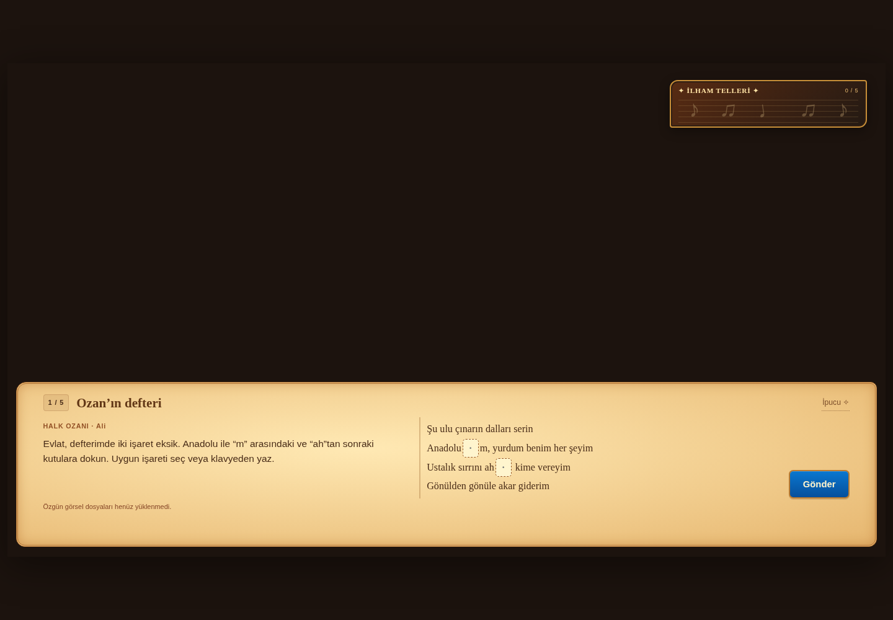
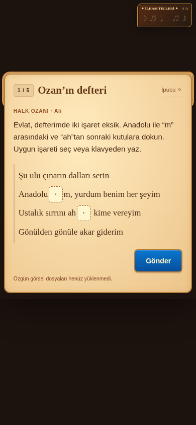
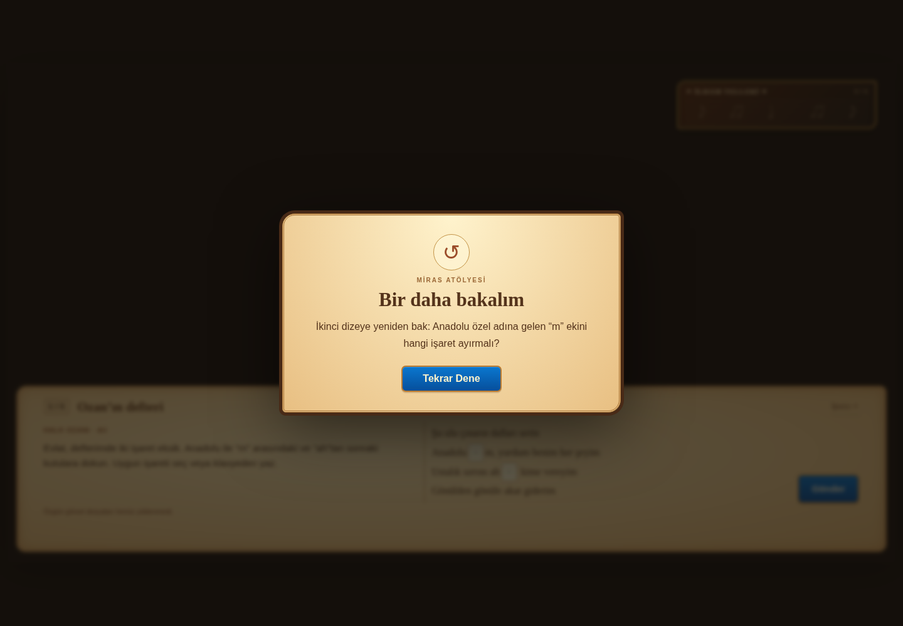

# Doğrulama sonuçları — 16 Ekim 2026

Bu rapor büyük parşömen, isim penceresi, ortadaki geri bildirimler, sağ üst ilham telleri ve sabit noktalama alanları eklenen sürüme aittir. Beş aşamalı oyun ve mevcut kod tabanı korunarak geliştirilmiştir.

**Özgün dosyalarla görsel onay bekliyor:** son iki görsel sohbette görülüyor, ancak indirilebilir `giris.png` ve `giris_sonrasi.png` dosyaları çalışma alanında veya GitHub deposunda bulunmuyor. Alternatif görsel üretilmedi. Yeni görüntünün 1672 × 941 oranı ve yaklaşık %64,6'da başlayan geniş parşömen alanı kullanıldı. Sentetik test görselleri yalnızca yükleme/geçiş mekanizmasını doğrular; özgün sanatın son görünümünü kanıtlamaz.

| Kontrol | Sonuç |
| --- | --- |
| Kural, metin denetimi ve paketleme testleri | **32 geçti, 0 başarısız, 0 atlandı** |
| Masaüstü 1440 × 1000 | Beş aşama ve final tamamlandı |
| Telefon 390 × 844 | Beş aşama ve final tamamlandı |
| Duyarlı yerleşim | 1920 × 1080, 1440 × 1000, 1280 × 720, 1024 × 768, 844 × 390, 768 × 1024, 390 × 844, 320 × 568 |
| Parşömen sınırları | İçerik üst sahneyi kapatmıyor; sayfa/parşömende yatay taşma yok; geniş ekranlarda normal içerik kağıda sığıyor |
| Girişte ek yazı | Parşömen formu ve ilham göstergesi gizli; iki görsel düğme isim penceresini açıyor |
| İsim ve geri bildirim pencereleri | Sekiz boyutta ortalanmış ve ekran sınırları içinde; animasyon bitişi de denetlendi |
| Oyna / Devam Et girişleri | İkisi de isim penceresini açtı; geçerli isimle oyun başladı |
| Noktalama sorusu | Serbest metin alanı yok; yalnızca iki kutu, seçenek menüsü ve klavye girişi var |
| Klavyeyle seçim | Odak, aşağı ok ve Enter ile işaret seçildi; doğrudan ünlem de girildi |
| Yanlış yanıt | Ortada Tekrar Dene penceresi açıldı; yanıt ve aşama korundu |
| Doğru yanıt | İlham notası doldu; Devam Et ile sonraki aşama açıldı |
| Özgün dize | Tek satırlık input; çok satırlı yapıştırma engellendi; uzunluk sınırı doğrulandı |
| Rastgele harfler | asdfasf, rrepj ve benzer girdiler engellendi |
| Uygunsuz sözler | Normal, çekimli ve bazı harf/rakam/ayraç gizlemeleri denetlendi |
| Yanlış pozitifler | ışık, şık, sıkıntımı, götürdü, amca, boks gibi normal sözcükler kabul edildi |
| Türkçe kökler ve ekler | Yaygın yaratıcı dizeler ve çekimler kabul edildi; öğrenci adı sözlükte olmasa da kullanılabildi |
| Öz yansıtma | Öğrencinin kendi dizesi aynen taşındı; büyük harf ve son işaret ayrı ayrı kontrol edildi |
| Öz değerlendirme | Üç seçeneğin tamamı geçerli; yanlış cevap yok |
| Final | İndir/ayar/ses düğmeleri yok; Tekrar Oyna yeni isim penceresini açıyor |
| Kayıt | Yenileme sonrası devam ve bozuk/kullanılamayan localStorage denetlendi |
| Taşınabilir HTML | Bütün harici kaynaklar engellendiğinde biçimli arayüz ve oyun çalıştı |
| Görsel yolları | Gömülü HTML ve modül kaynak şablonunda sentetik görsellerle giriş/oyun geçişi geçti |
| Standart PNG adları | Dosyalar JSON düzenlemeden bulundu, değiştirilmeden gömüldü |
| Ayrılmış sunucu günlük kanalı | Günlük okuyucusu kapalıyken HTTP yanıtı ve gömülü kaynaklar çalıştı |

## Kapsam ve sınırlar

Türkçe kök/ek kontrolü çevrimdışıdır. Zemberek'in kök sözlüğünden türetilen liste ve sınırlı ek kontrolü kullanılır; tam Zemberek çözümleyicisi çalıştırılmaz. Nadir veya yeni türetilen sözcükler tanınmayabilir. Bu sistem bir cümlenin anlamını veya edebî niteliğini puanlamaz. Uygunsuz ifade filtresi de kapsamı sınırlı yerel kurallar içerir. Girdiler harici bir servise gönderilmez.

Yönetilen tarayıcının önceki `file://` engeli devam eden bir platform kısıtıdır. Bu sürüm HTTP üzerinden test edilmiştir; kısıt aşılmamıştır.

## Komutlar

Depo kökünde:

```sh
python3 miras-atolyesi/scripts/build.py --repo-entry
node --test miras-atolyesi/tests/*.test.js
python3 miras-atolyesi/tests/server_smoke.py
python3 miras-atolyesi/scripts/serve.py
```

Ayrı terminalde `python3 miras-atolyesi/tests/browser_smoke.py` çalıştırılır. Farklı sunucu/port için `--base-url` verilir.

## Ekran görüntüleri

Özgün dosyalar henüz erişilebilir olmadığı için aşağıdaki görüntülerde üst sahne nötrdür. Görüntüler yeni parşömen, ilham telleri, noktalama kutuları ve ortadaki pencerelerin teknik yerleşimini gösterir.






